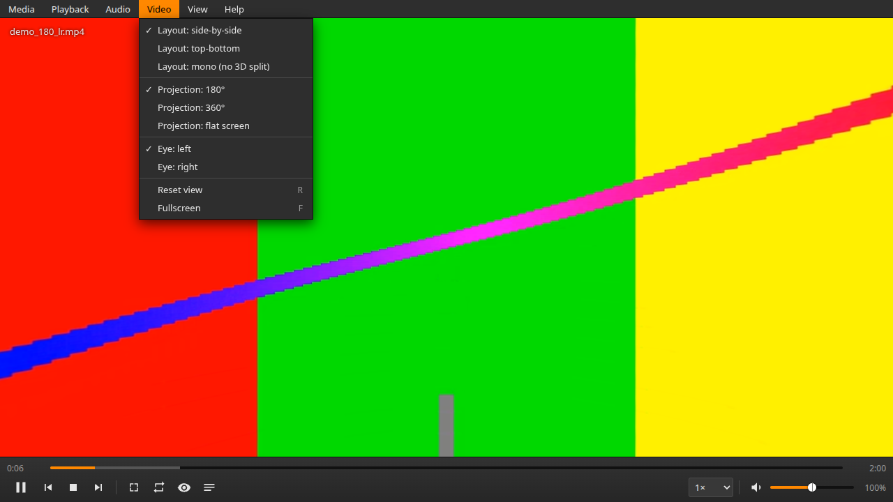

# vr-player

Tiny local browser player for VR videos (side-by-side / top-bottom, 180° / 360° / flat). Drag to look around. VLC-style UI.



## Run

```
python3 serve.py            # then open http://127.0.0.1:8000 and drag a video onto the page
python3 serve.py movie.mp4  # optional: preload a file
```

Options: `--port N`, `--host H` (default localhost only). Needs Python 3 and internet once for three.js (CDN).

## Controls

Drag = look, wheel = zoom, click = play/pause, double-click = fullscreen. Wheel on the time bar = ±10s, on the volume bar = ±5% (stops at 100%, drag for up to 200%). Layout, projection and eye are in the Video menu; Help ▸ Keyboard shortcuts lists the rest.
